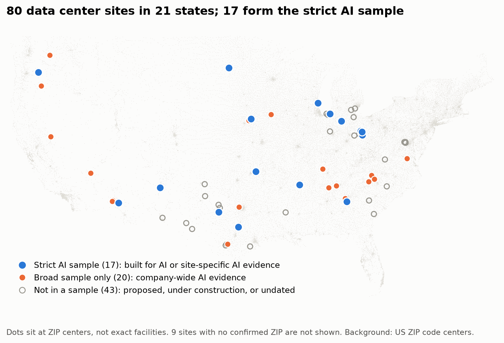
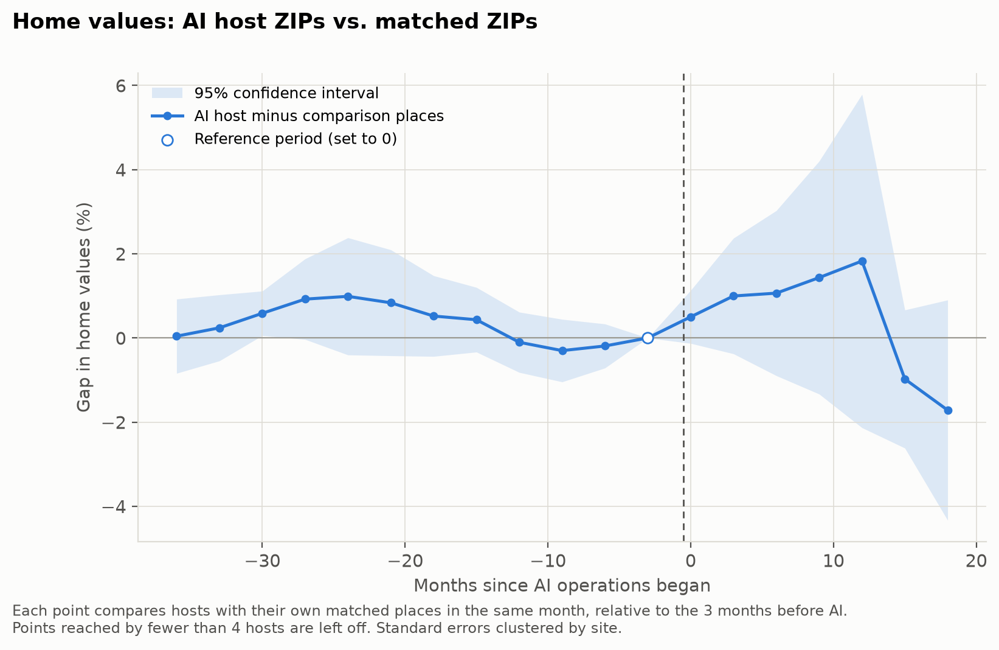
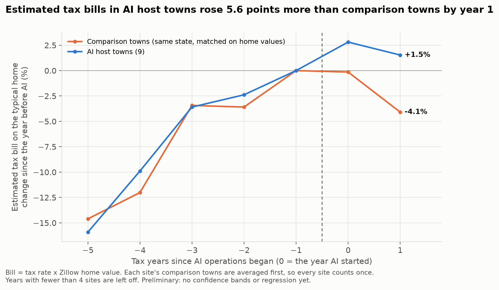
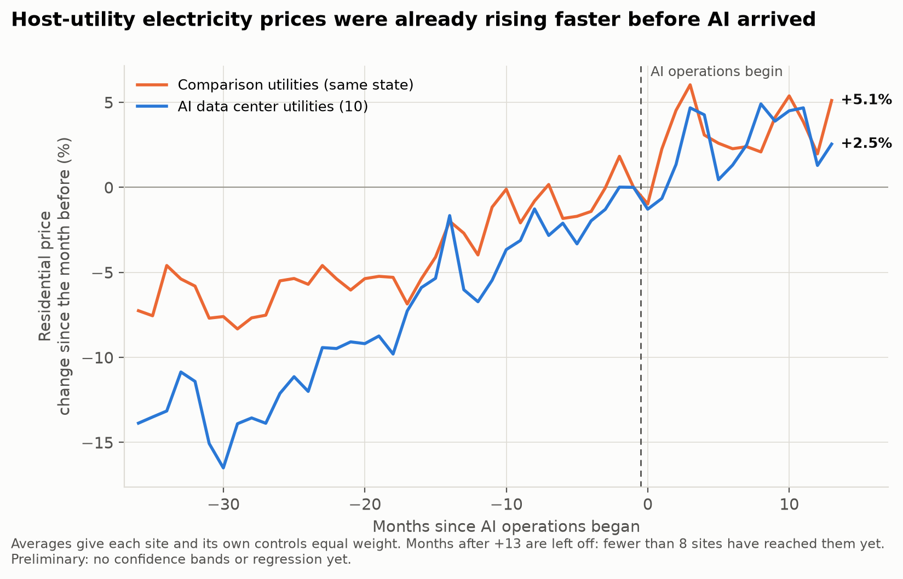
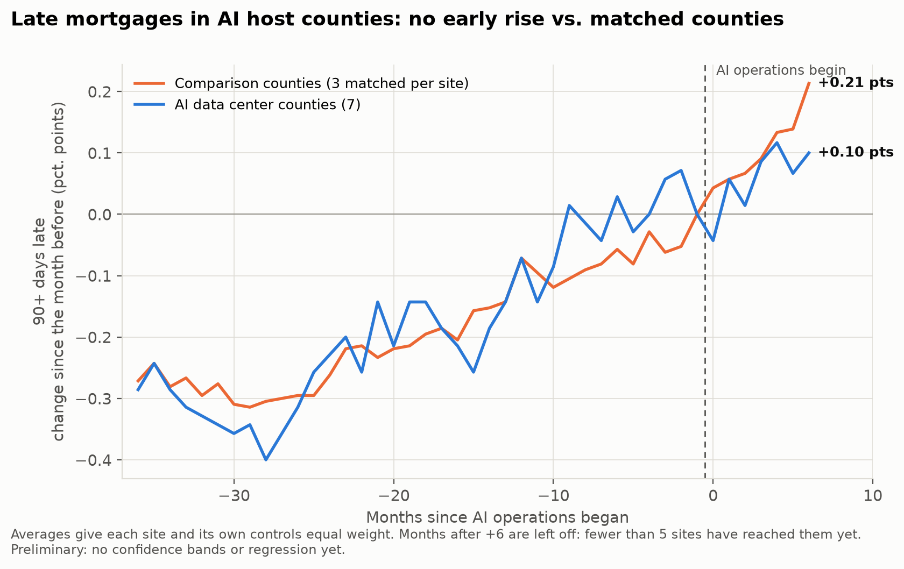
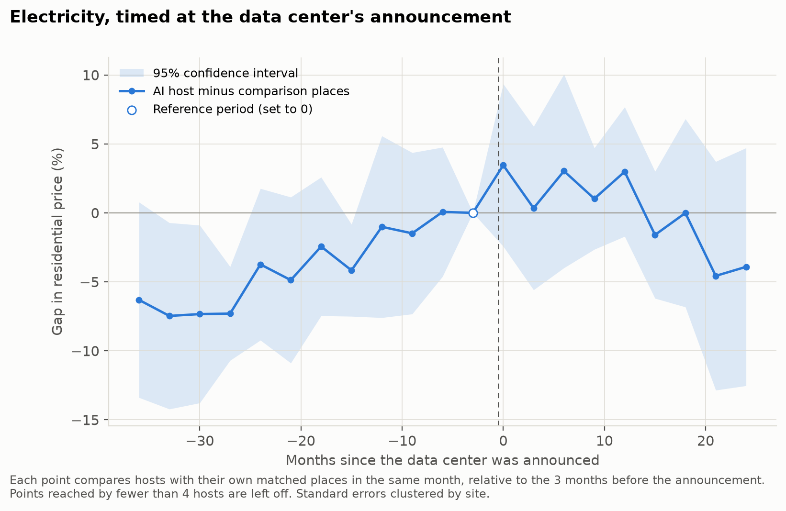

# What AI Data Centers Cost Their Host Towns

**ECO 3630 Final EDA Project · Baruch College · Fall 2026**

Do AI data centers raise the cost of living in the towns that host them? We
track home values, rents, electricity prices, water and property tax rates
in 80 U.S. data center locations, compare AI sites to matched towns without
one, and test whether higher costs show up as more late mortgage payments.

> **Status:** Setup, treatment and comparison groups, matching, and all outcome data
> (Zillow, EIA electricity, CFPB delinquency, property tax and water) complete.
> Data audited and regressions run (Phase 4). Next: write-up and presentation.



**Main result: home values in AI host ZIPs vs. their matched comparison ZIPs**



## Quick start

All the data is already in the repo (`data/raw/` holds every original download,
`data/processed/` every cleaned table), and no API keys are needed. Pick one:

**A. See the results without installing anything.** Open
[`notebooks/00_start_here.ipynb`](notebooks/00_start_here.ipynb) on GitHub. It is saved
with every table and chart already showing.

**B. Run it in Google Colab (nothing to install).**
[](https://colab.research.google.com/github/strohjio/eco3630-ai-datacenters/blob/main/notebooks/00_start_here.ipynb)
→ **Runtime → Run all**. The first cell downloads the repo and installs the packages (about 1 minute).

**C. Run it in VS Code.** You need [Python 3.10+](https://www.python.org/downloads/) (on
Windows, tick *Add python.exe to PATH* when installing) and VS Code's Python and Jupyter extensions.

1. Get the code: **Code → Download ZIP** on GitHub and unzip it, or `git clone https://github.com/strohjio/eco3630-ai-datacenters.git`
2. In VS Code: **File → Open Folder** → the `eco3630-ai-datacenters` folder
3. **Terminal → New Terminal**, then:

```bash
pip install -r requirements.txt     # or: python -m pip install -r requirements.txt
python scripts/check_setup.py       # every line should say OK
python scripts/run_all.py           # audit + all regressions, about 3 minutes
```

Or open `notebooks/00_start_here.ipynb`, choose your Python as the kernel (top right), and **Run All**.

| Command | What it does | Time |
| --- | --- | --- |
| `python scripts/run_all.py` | data audit + every regression, table and event-study chart | ~3 min |
| `python scripts/run_all.py --quick` | same, 50 placebo draws instead of 300 | ~1 min |
| `python scripts/run_all.py --full` | rebuild every table from `data/raw/` first, then the results | ~6 min |
| `pytest -q` | 60 checks that the code does what it says | ~10 s |

Every step below is also its own script and can be run alone, in any order
after the first clone, because every input it needs is already saved.

## Pipeline: run in this order

| Step | Command | Makes | Status |
| --- | --- | --- | --- |
| 0. Setup check | `python scripts/check_setup.py` | nothing; checks your setup | Done |
| 1. Treatment and control pools | `python scripts/build_treatment.py` | `treated_*.csv`, `control_candidates_*.csv`, map, timeline | Done |
| 2a. Zillow | `python scripts/pull_zillow.py` | `zhvi.csv.gz`, `zori.csv.gz` | Done |
| 2b. Electricity | `python scripts/pull_eia.py` | `elec_state.csv`, `elec_utility.csv.gz`, `elec_county.csv.gz`, host-utility table, figure | Done |
| 2c. Delinquency | `python scripts/pull_cfpb.py` | `delinq.csv`, county coverage, 3 matched counties each, figure | Done |
| 2d. Tax comparison towns | `python scripts/build_tax_controls.py` | `data/property_tax_controls.csv` (needs raw state files) | Done |
| 2e. Property tax, water | `python scripts/build_water_tax.py` | `proptax.csv`, `water.csv`, `proptax_bill_panel.csv`, figures | Done (gaps below) |
| 2f. Control variables | `python scripts/pull_controls.py` | `controls_county.csv`, `controls_nation.csv`, balance table | Done |
| 3. Matching | `python scripts/match_controls.py` | `control_zip_*.csv`, balance table, event-path figures | Done |
| 4a. Data audit | `python scripts/audit_data.py` | `audit_report.csv` (format, duplicates, ranges, gaps, coverage) | Done |
| 4b. Regressions | `python scripts/run_regressions.py` | `results_did.csv`, `results_event_*.csv`, `results_mediation.csv`, `figures/es_*.png` | Done |
| All of the above | `python scripts/run_all.py --full` | everything, in this order | Done |

The four biggest tables are saved compressed (`.csv.gz`) to fit on GitHub;
`pd.read_csv` opens them like any CSV.

### Getting the Zillow files

These are already in `data/raw/` (home values as 5 pieces). To refresh them with newer months,
download by hand (Zillow's site blocks automated downloads):
[zillow.com/research/data](https://www.zillow.com/research/data/) →
**Home Values**: *ZHVI All Homes (SFR, Condo/Co-op) Time Series, Smoothed, Seasonally Adjusted*,
geography *ZIP Code* → Download; **Rentals**: *ZORI (Smoothed): All Homes Plus Multifamily*,
geography *ZIP Codes* → Download. Save both CSVs in `data/raw/`.
`pull_zillow.py` also accepts the smaller versions made by `scripts/shrink_zillow.py`
(project states, 2015 on) and the pieces from `scripts/split_csv.py`.
Use the full download when you can: the oldest broad-sample sites need pre-2015 history.

### What the data covers (Zillow through September 2026)

- **Home values:** all 15 strict treated ZIPs have complete data; 23 of 32 broad
  ZIPs match with the 2015-on file (the other 9 opened 2007-2017 and need the full file).
- **Rents:** 3 strict ZIPs have no Zillow rent series (New Carlisle IN, Mount Pleasant WI,
  Ellendale ND), and several start only around their treatment date. About 8 sites
  support a rent analysis.

### Getting the EIA and CFPB files (free, no key)

Save in `data/raw/eia/`, from [EIA-861M](https://www.eia.gov/electricity/data/eia861m/):
`sales_revenue.xlsx` and one `sales_ult_cust_<year>.xlsx` per year from 2019
(2019 and 2020 are under *Archived data* as `retail_sales_<year>.xlsx`: rename them).
From [EIA-861 annual](https://www.eia.gov/electricity/data/eia861/), unzip
`Service_Territory_2025.xlsx` from `f8612025.zip` into `data/raw/eia/f861_2025/`.
Save in `data/raw/cfpb/` the two **County** files from
[CFPB Mortgage Performance Trends](https://www.consumerfinance.gov/data-research/mortgage-performance-trends/)
(90+ days late and 30-89 days late).

### Control variables (Census, BLS, FRED)

Every U.S. county, from the agencies' published files (the Census API now needs a key;
these files don't). Download links are at the top of `scripts/pull_controls.py`.

| Variable | Source | Years |
| --- | --- | --- |
| `pop`, `pop_growth_pct` | Census population estimates (July 1) | 2010-2024 |
| `med_hh_income`, `poverty_rate` | Census SAIPE | 2019-2024 |
| `unemp_rate`, `labor_force` | BLS LAUS, annual | 2018-2025 |
| `unemp_rate_m` | BLS LAUS, monthly, not seasonally adjusted | Aug 2025-Sep 2026 |
| `cpi` (national) | FRED CPIAUCSL | monthly, to Sep 2026 |
| `mortgage30` (national) | FRED MORTGAGE30US, monthly average | to Nov 2026 |

Yearly values are stored at January of their year. `src.controls.deflate()` adds
inflation-adjusted dollars (team rule 4). BLS's 2025 annual figure is an 11-month
average, and October 2025 is missing from the monthly file: it was never collected
during the 2025 federal funding lapse. Population estimates switch vintage in 2020, so
2020 growth mixes two series.

**Balance check (2023):** host counties and their comparison counties are close on
income (+$3.5K), poverty (-0.7 pts), unemployment (equal) and population growth
(-0.3 pts). Host counties are much bigger on average, mostly because of Maricopa
County (4.5 million people). That's why population enters the regressions as a control.

### What the electricity and delinquency data cover

- **Electricity prices** are revenue / sales (cents per kWh), checked against EIA's own
  price column (they agree to within 0.01 cents). States go back to 2010; utilities
  and counties start in 2019. Data run through August 2026.
- **Why utilities:** one utility charges the same rates across its whole area, so a host
  county and a nearby control county often share a price by construction. The
  electricity comparison is the **host utility vs. other utilities in the same state**.
  Each host county's utility is in `data/host_utility_choice.csv`. Rows marked
  `verified=False` were picked automatically (the county's largest utility) and need a
  check by hand. Checked by the team: Pryor homes buy from the city's Municipal Utility
  Board ([mubpryor.org](https://mubpryor.org/)), which files only EIA's annual short form, so
  **Pryor is left out of the electricity regression** (10 host utilities, not 11). The Dalles
  homes are served by Pacific Power (PacifiCorp).
- **Texas has no utility series:** under retail choice, EIA's monthly file lists retail
  sellers, not the wire companies. Temple and Abilene use the Texas state series.
- **First look at electricity:** host utilities' prices were *already* rising faster than
  other utilities' for three years before AI arrived. That breaks the parallel-trends
  assumption, so the regression must control for each utility's own trend (or use state-level
  comparisons) before any post-AI gap means anything.
- **Delinquency:** the CFPB publishes only about 500 larger counties. 9 of 15 strict host
  counties are covered, and with data through March 2026, **7 have months after AI**
  (3 to 26 months). Each is matched to 3 same-state counties (most states have fewer than 10
  covered candidates). Before AI the two groups move together closely; after AI there is
  no early rise in host counties. This test has low power and the report should say so.

### Property tax and water (hand-collected from official sources)

Every value is in `data/property_tax_rates.csv` or `data/water_bills.csv` with the
official document it came from (`source_url`) and how it was computed. The raw
state files are in `data/raw/tax/<state>/` (not committed; 240 MB).

- **Property tax: 14 of 15 strict places**, mostly 2019-2025, from state sources:
  Indiana DLGF, Texas Comptroller, Tennessee Comptroller, Iowa Dept. of Management,
  Georgia DOR plus Fayette County, North Dakota and Oregon tax departments, Oklahoma
  State University's mill levy reports, New Mexico DFA, Maricopa County, Fairfield County
  (OH) Auditor, Wisconsin DOR. The rate is tax per $100 of *taxable* value, and states tax
  different shares of market value, so **each place is compared with itself over time**.
  Missing: New Albany, OH (Licking County publishes no rate history online; only school
  rates for 2020-2022 were found). Mount Pleasant has 2023-2025 only.
- **First look at rates:** host-town tax rates were already falling for several years
  before AI arrived (rising property values let towns cut rates), and keep falling after.
- **Comparison towns** (`data/property_tax_controls.csv`): for 9 sites, every matched
  control ZIP's town is measured the same way as its host town, from the same state file
  (IN, IA, TN, TX, OK by town; ND, OR by county average). 92 of 100 towns were found;
  8 unincorporated places with no town tax district are left out, not guessed.
  Not possible: Mesa (Arizona's file covers only Maricopa County), Fayetteville (Georgia's
  recent files are scans), Lancaster (Ohio county file only), Mount Pleasant (no year
  after AI yet), Los Lunas (no facility ZIP, so no matched controls).
- **Estimated tax bill = rate x Zillow home value**, for host and comparison towns
  (`proptax_bill_panel.csv`). This is what residents pay, and it's the regression outcome
  (`log_tax_index`). Before AI the two groups move together within a few points; after
  AI, host-town bills rose about 3 points more in the AI year (7 sites) and about 6 points
  more a year later (4 sites). Preliminary: few post-AI years, no regression yet. Memphis
  2025 is a reappraisal year, and Texas cut school rates statewide in 2023 (the
  comparison towns absorb both, which is why they matter).
- **Water: 11 of 15 places** have official dated rates (Mesa, Fort Wayne, Memphis,
  Los Lunas, Pryor, The Dalles, Mount Pleasant/Racine, Temple, Lancaster, Fayetteville;
  Abilene's figure is water + sewer). Bills are at 5,000 gallons a month (Mesa: its own
  6,000-gallon "typical bill"). Not found online: Council Bluffs, New Carlisle,
  Ellendale, New Albany. Water is for case studies, not regressions: few rate changes,
  no comparison towns. Water rates change rarely (Memphis: none
  since Jan 2022; Los Lunas: none from 2015 until Oct 2025), so water is best reported as
  dated case-study events, not a regression outcome.
- **Rows to double-check** (values read from web pages, not parsed from a file): Mesa,
  Memphis, Racine and Los Lunas water. Open each `source_url` and confirm the number.
  Fort Wayne's school district and the Abilene/Temple school districts are flagged in
  the notes.



**Data audit notes** (`python scripts/audit_data.py`): no duplicates or broken values. Flags that are
expected and left as is: 7 ZIPs with extreme Zillow rents (none in the study); one-month price
glitches at a few small utilities (none hosts or comparisons); Connecticut's 2022 county redraw in
population growth; October 2025 missing from BLS monthly data. One bug was fixed: a national
rooftop-solar row (EIA utility 88888) had slipped into the utility table.

**Gaps left open on purpose** (filling them would bias the results or adds nothing):
no averaging or carrying values forward for any missing site; no ACS rent substitute
(Census 5-year rent data end in 2024, before most AI start dates); Texas electricity
delivery charges would add only one post-AI site and are left as an extension.





Walkthrough with outputs: `notebooks/01_treatment_and_controls.ipynb`.

**Google Colab instead?** Upload the repo folder, then run
`!pip install -r requirements.txt` in the first cell.

**In a notebook**, add this first so `src` can be imported:

```python
import sys; sys.path.insert(0, "..")
from src import config
from src.io_utils import load_site_panel, sample
```

## Results (Phase 4)

**Method.** Difference-in-differences: each AI host is compared only with its own
matched comparison places in the same month (place fixed effects + match-group x month
fixed effects), standard errors clustered by site. Because there are only 7-23 sites,
every main estimate also gets a **placebo test** (a comparison place pretends to be the
host, 300 times; the p-value is how often a fake effect is as big as the real one) and a
**leave-one-site-out** check. Code: `src/regress.py`; tests in `tests/test_regress.py`
show it recovers a known effect from fake data.

| Outcome | Estimate | Std. error | p | Placebo p | Hosts | Holds up? |
| --- | --- | --- | --- | --- | --- | --- |
| Home values, strict sample | +0.3% | 1.0 | 0.76 | 0.82 | 15 | No effect |
| Home values, broad sample | +1.8% | 1.1 | 0.11 | **0.04** | 23 | Suggestive; +2.6% (p 0.05) with controls |
| Rents | +6.4% | 5.4 | 0.23 | (0.00) | 12 | **No: Abilene alone.** Without it, +1.0% (se 2.5) |
| Electricity price, AI start | +2.9% | 2.4 | 0.22 | 0.28 | 10 | Not at AI start (prices rose earlier) |
| Electricity price, timed at announcement | +4.7% | 1.8 | 0.007 | 0.10 | 10 | **Mostly a steady climb, not a jump** (see chart) |
| Electricity, own utility trends | -3.4% | 2.4 | 0.16 | | 10 | No break once each utility's trend is removed |
| Property tax bill | +2.2% | 4.2 | 0.60 | 0.58 | 9 | No effect; Memphis moves it most |
| Mortgages 90+ days late | +0.00 pts | 0.05 | 0.96 | 0.98 | 7 | No effect (short post-AI window) |

**Costs -> late mortgages** (222-244 CFPB counties in the project's states, 2018-2025,
county and state x month fixed effects, unemployment control): counties whose home values
grew 1 SD faster had **0.020 pts fewer** mortgages 90+ days late a year later (p 0.01;
rising values build owners' equity). Electricity price growth: no link (+0.004, p 0.59).
So the data give no sign that AI-driven cost increases pushed homeowners into
delinquency: the implied effect through home values is about -0.001 pts.

**How to read this honestly:** the clearest pattern is in electricity, but it is a
*trend*, not a break. Utilities that host AI data centers raised residential prices about
6 points more than other utilities in their state over the three years before the
announcement, and the gap keeps moving after it. A before/after comparison picks that up
as +4.7%, but once each utility's own trend is allowed for, nothing is left at either the
announcement or the AI start. Host utilities are on a steeper price path (plausibly the
grid build-out for large new loads, data centers included), but these data can't pin that
on the specific AI site. Everything else is a well-measured "no detectable effect yet",
limited mainly by time: most AI starts are in 2025, so there are only 1-2 years after them.

Event-study charts (95% intervals): `figures/es_zhvi_strict.png`, `es_zori_strict.png`,
`es_elec_strict.png`, `es_elec_announce.png`, `es_tax_strict.png`, `es_delinq_strict.png`.



## The question, in three parts

1. **Prices:** did home values, rents and electricity prices in AI data
   center areas change more than in comparable areas after AI arrived?
2. **Who pays:** did water and property tax rates in host towns go up or down?
3. **Strain:** did rising costs show up as more mortgages 90+ days late?

## Data

| Dataset | Source | Level | Frequency |
| --- | --- | --- | --- |
| Data center sites | Hand-compiled from county filings, utility dockets, operator announcements | Site | One row per site |
| Home values (ZHVI), rents (ZORI) | [Zillow Research](https://www.zillow.com/research/data/) | ZIP | Monthly |
| Electricity prices and sales | [EIA-861M](https://www.eia.gov/electricity/data/eia861m/) | State, utility, county | Monthly |
| Utility service areas | [EIA-861 annual](https://www.eia.gov/electricity/data/eia861/) | Utility to county | 2025 |
| Mortgages 90+ and 30-89 days late | [CFPB Mortgage Performance Trends](https://www.consumerfinance.gov/data-research/mortgage-performance-trends/) | County (about 500) | Monthly |
| Property tax rates | State tax departments and county auditors (see `property_tax_rates.csv`) | Town / tax district | Yearly |
| Water bills | City utility rate schedules and state rate orders (see `water_bills.csv`) | Town | Each rate change |
| Population | Census population estimates | County | Yearly |
| Income, poverty | Census SAIPE | County | Yearly |
| Unemployment | BLS Local Area Unemployment Statistics | County | Yearly + last 14 months |
| Inflation, mortgage rates | FRED `CPIAUCSL`, `MORTGAGE30US` | National | Monthly |

## How treatment and controls are defined

- **Treated place:** a ZIP (from a facility's published address) or county with
  a strict-sample site. Sites sharing a place collapse to one, dated by the
  earlier site. 17 strict sites give 15 treated ZIPs and 15 treated counties.
- **Treatment month:** when AI operations began (`treat_month`). The
  announcement month is a second date for testing announcement effects.
- **Control candidates:** same-state ZIPs at least 15 miles from every panel
  site and outside every host county (10,273 ZIPs).
- **Matched controls:** the 10 candidates whose home values had the most
  similar level and growth over the 36 months before treatment.

**The site panel** (`data/ai_data_center_site_panel.csv`) lists 80 data
centers in 21 states. Every column is explained in
`data/site_panel_data_dictionary.csv`. Two samples are built in:

- **Strict AI sample (17 sites):** operating, with a confirmed AI start month,
  and either built for AI or with evidence that this specific site runs AI.
  This gives the headline result.
- **Broad sample (37 sites):** adds hyperscale sites whose only AI evidence
  is company-wide. Used as a robustness check.

## Repo layout

```
data/
  ai_data_center_site_panel.csv     the master list of sites
  host_utility_choice.csv           which utility serves each host county (edit by hand)
  property_tax_rates.csv            hand-collected tax rates, one row per place/year/levy
  water_bills.csv                   hand-collected water bills, one row per rate change
  property_tax_controls.csv         same tax measure for host and comparison towns
  site_panel_data_dictionary.csv    what every column means
  raw/                              every original download (public data, committed)
  processed/                        cleaned tables, shared long format (big ones .csv.gz)
notebooks/
  00_start_here.ipynb               all results + re-run buttons; works in VS Code and Colab
  01_treatment_and_controls.ipynb   Phase 1 walkthrough, outputs saved
src/
  config.py                         paths, study window, API keys
  io_utils.py                       shared readers/writers (the team rules)
  validate.py                       checks the site panel is consistent
  treatment.py                      who is treated, and when
  geo.py                            distances and control candidate pools
  matching.py                       picks 10 matched controls per treated ZIP
  zillow.py                         Zillow files -> shared long format
  eia.py                            EIA files -> state/utility/county electricity tables
  cfpb.py                           CFPB files -> county delinquency table
  controls.py                       Census, BLS, FRED controls; inflation adjustment; balance check
  regress.py                        DiD, event study, placebo test, leave-one-out (one estimator)
  mediation.py                      cost index -> late mortgages across all CFPB counties
  figures_results.py                event-study charts
  water_tax.py                      tax and water CSVs -> checks, monthly long format
  tax_bill.py                       estimated tax bill (rate x home value) panel
  figures_water_tax.py              tax-rate and tax-bill event charts
  panel.py                          monthly analysis panel, event time, deltas
  figures_matching.py               treated vs. control event-path chart
  plotting.py                       shared colors and chart style
  figures_phase1.py                 site map and treatment timeline
scripts/
  check_setup.py                    run first
  run_all.py                        every step in order, one command
  set_github_user.py                puts your GitHub username into the links (run once)
  build_treatment.py                Phase 1 outputs
  pull_zillow.py                    Zillow -> data/processed/zhvi.csv, zori.csv
  pull_eia.py                       EIA -> elec_*.csv, host utilities, electricity figure
  pull_cfpb.py                      CFPB -> delinq.csv, county matching, delinquency figure
  pull_controls.py                  Census/BLS/FRED -> controls_county.csv, controls_nation.csv
  audit_data.py                     checks every processed table before the regressions
  run_regressions.py                every regression, tables and event-study charts
  build_tax_controls.py             comparison towns' tax rates from the state files
  build_water_tax.py                tax and water -> proptax.csv, water.csv, tax-bill panel, figures
  match_controls.py                 matching, balance table, event-path figures
  shrink_zillow.py                  cut a Zillow file to project states, 2015 on
  split_csv.py                      split a big CSV into pieces
tests/                              pytest checks for src/
figures/                            exported charts (PNG, 200 dpi)
```

## Team rules (enforced in `src/io_utils.py`)

1. **IDs are text.** Read every CSV with `dtype=ID_DTYPES`, or ZIP `01001`
   becomes `1001` and joins silently fail.
2. **Dates are month starts.** Use `to_month_start()`.
3. **One output shape.** Every processed table has the columns
   `geo_id, geo_type, month, variable, value`. Save with `save_long()`.
   `geo_type` is `zip`, `county` (5-digit FIPS), `state` (postal code like `OH`)
   or `utility` (EIA number and state, like `9324_IN`).
4. **Real dollars.** Keep nominal values and add an inflation-adjusted column.
5. **One look.** Call `apply_style()` and use `COLORS` from `src/plotting.py`:
   AI places are always blue, controls always orange.
6. **Edited the site panel by hand?** Run `python scripts/check_setup.py`.

## Who does what

| Member | Owns |
| --- | --- |
| Jiovani Hernandez | Site panel, treatment dates, comparison group, water and tax data, controls, cost index and delinquency model |
| Timothy | Zillow home values and rents: pull, panel, plots, regressions |
| Tiffany | EIA electricity and CFPB delinquency: pull, panel, plots, regressions |

## AI use disclosure

This is an AI-open assessment. We used Claude (Anthropic) to research and
compile the data center site panel, draft the project plan, and write the
starting code in `src/`, `scripts/` and `tests/`. Every team member has
reviewed and can explain the code in their module. .
